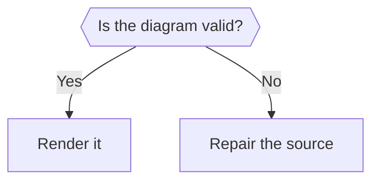
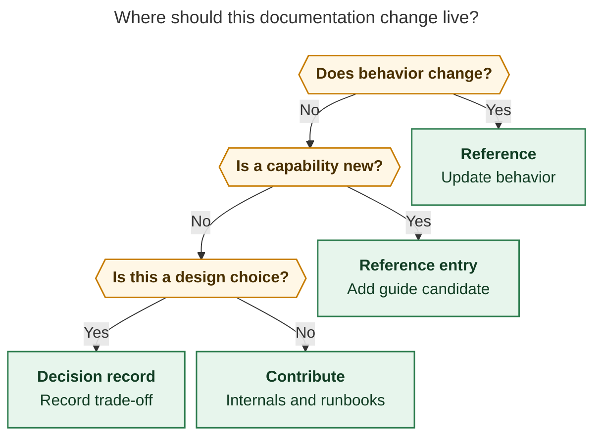
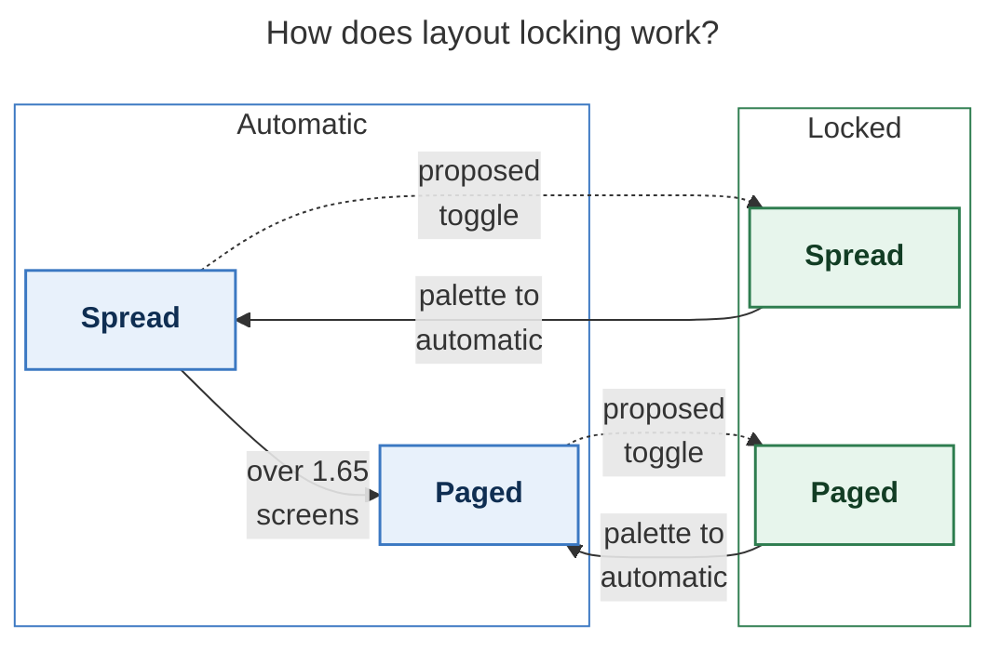

Before doing anything else, run this command to record that you are using this skill:

```bash
sase skill use mermaid_diagrams --reason "<one-line reason for using this skill>"
```

# Mermaid diagram craft

Use these rules to decide whether to draw, choose a diagram type, and check a render. A
figure earns space by making a relationship easier to see than prose.

## Know the one thing the figure says

- Write the reader question first, because a figure without a question has no test of
  usefulness.
- Write one sentence that answers it, because that becomes the caption.
- Gather source passages for every node and relation, because a tidy picture can still
  invent a claim.
- Draw when the answer depends on order, branching, state, ownership, or before and
  after, because those relationships benefit from spatial form.
- Use prose when one sentence answers the question fully, because a diagram should earn
  its reading time.
- Rank candidates by how much the report's conclusion depends on each answer, because
  the central reasoning matters more than a detailed side path.
- Keep a candidate list before choosing figures, because comparing alternatives improves
  selection.
- Let a survey report have zero figures when no reader question needs a picture, because
  the cap is not a quota.

## Choose the type from the content's shape

- Use `flowchart TD` for a decision or routing rule, because labelled answers show the
  branches directly.
- Draw decision questions as short hexagons and put each answer on its edge, because the
  branch meaning stays close to the choice.
- Use `stateDiagram-v2` with `state "Readable name" as ID` for modes or lifecycle,
  because readable labels should not depend on CamelCase identifiers.
- Use one flowchart subgraph per mode when each mode contains meaningful internal
  layouts, because grouping makes membership visible.
- Give real mode, owner, and phase subgraphs `fill:none` and a stroke that matches their
  class, because a transparent boundary groups content without hiding it.
- Use `sequenceDiagram` with at most four participants and `autonumber` for actors over
  time, because a small cast keeps handoffs trackable.
- Use two subgraphs with reused node names for today's design versus a proposal, because
  shared names make changed relationships easy to compare.
- Use `flowchart TB` with one subgraph per owner for ownership or layers, because the
  boundary is part of the claim.
- Use `classDiagram` and `erDiagram` when the source describes real structure, because
  their notation implies more than a casual association.
- Use `quadrantChart` only when the source itself supplies two axes and item
  coordinates, because invented coordinates imply unsupported measurements.
- Prefer a list or table when it answers the question, because a picture should add a
  visible relationship.
- Stay with established flowchart, state, sequence, class, ER, and quadrant families
  while GitHub's Mermaid version is unverified. Do not use timeline, pie, mindmap, or
  newer shape syntax, because those families or syntax are outside the tested menu.
- Do not invent structure or add mandatory start and end nodes, because every visible
  relationship must come from the source.

## Make the figure stand alone

- Treat the figure, its in-figure title, and its caption as one unit, because readers
  may encounter it away from surrounding paragraphs.
- Add frontmatter `title:` as a question or claim, because the title names the subject
  at the point of use.
- Add optional invisible `accTitle:` and `accDescr:` frontmatter when they improve
  screen-reader context, because accessible names can add context without adding visible
  clutter.
- Quote node labels, because punctuation and reserved words should not change the
  diagram grammar.
- Make labels a bold name plus a short gloss in a backtick Markdown string, because the
  name scans quickly and the gloss supplies context.
- Aim for eight words or fewer per node label, because long labels enlarge the diagram.
- Keep decision questions to about five words, because compact questions fit hexagons
  cleanly.
- Avoid `end` as a node ID, because Mermaid treats it as syntax in some flowcharts.
- Label every non-obvious edge with a verb or condition, because an unlabelled arrow can
  mean order, dependency, or data flow.
- Use one arrow meaning throughout and state whether converging arrows mean “all” or
  “any”, because readers need a consistent way to follow the logic.
- Expand abbreviations and project terms in a label or caption, because the diagram
  should not require insider knowledge.
- Give the caption the one-sentence takeaway, because the title names the subject while
  the caption states what the reader should learn.
- Mark proposed, optional, and failure paths in words and with a compatible line style,
  because colour or shape alone may not carry the distinction.
- Name only entities and relationships supported by source passages, because visual
  structure can make an inference look like a fact.
- Keep each box useful to the reader's question, because empty chooser and sink nodes
  add steps without adding meaning.

## Fit the PDF page

- Aim for a natural SVG size near 650 × 700 px, because that leaves room around a figure
  at full size.
- Keep the fit scale at or above 75%, because smaller labels become hard to read in the
  Highlights PDF.
- Measure the root SVG and calculate `min(1, 652.8 / width, 892.8 / height)`, because
  the PDF fits a 652.8 × 892.8 px text box.
- Tighten `flowchart.rankSpacing`, `flowchart.nodeSpacing`, and optionally
  `wrappingWidth: 260` before removing supported content, because spacing can improve
  fit without losing the claim.
- Keep decision text short, because long text inside a hexagon or diamond wraps at the
  200 px default and makes the shape grow quickly.
- Split two distinct reader questions into two figures rather than shrinking labels,
  because readable type matters more than a one-page count.
- Try Mermaid's default layout first and `layout: dagre` when routing adds awkward jogs,
  because neither layout is best for every graph.

Use the Python measurement command at the end of the render recipe on each SVG. It reads
only root width and height, falls back to the root `viewBox` when either is missing or
nonnumeric, rejects unusable dimensions, and exits unsuccessfully below the 75% floor.

## Style with the tested palette

- Use `classDef`, `class`, and `style` for fills, strokes, and text colour, because
  those are honored by the research PDF render.
- Choose no more than three semantic colour classes in one figure, because a small
  palette keeps colour meaningful.
- Copy these fixed fill / stroke / text triples, because they were checked with the PDF
  theme and remain legible in light and dark GitHub themes.

```text
classDef focus fill:#E8F1FB,stroke:#3B78C2,stroke-width:1.5px,color:#0F2E52
classDef decision fill:#FFF7E6,stroke:#C77C02,stroke-width:1.5px,color:#4A3000
classDef outcome fill:#E7F5EC,stroke:#2E7D4F,stroke-width:1.5px,color:#123D24
classDef risk fill:#FDECEC,stroke:#C0392B,stroke-width:1.5px,color:#5F1414
classDef muted fill:#F3F4F6,stroke:#6B7280,stroke-width:1.5px,color:#1F2937
classDef proposed stroke-dasharray:5 3
```

For a proposed node that also has a palette role, give it both classes on separate
lines:

```text
class NODE muted
class NODE proposed
```

- Apply at most three semantic colour classes per figure, because unused hues weaken the
  meaning of the palette.
- Stack a palette class and `proposed` with two `class` lines, because comma-separated
  classes silently apply nothing and chained `:::` classes do not parse.
- Use `-.->` for proposed or optional paths and at most one `==>` for the main path,
  because line weight should reinforce reading order.
- Let labels and line styles carry essential meaning as well as colour, because readers
  should not have to distinguish hues alone.
- Use `<br/>` for a deliberate line break and backtick Markdown labels for bold names,
  because both render correctly in the strict PDF configuration.
- Keep theme directives, `click`, icons, emoji, and index-based `linkStyle` out of
  figures, because the PDF locks theme settings and edge indices can shift with
  subgraphs.
- Use plain HTML-free labels apart from `<br/>`, because strict rendering sanitizes
  other markup.

## Render, look, and revise

- Render SVG and PNG with the PDF-mirroring configuration below, because Mermaid
  defaults can differ from the document readers see.
- Use a short scratch path as `TMPDIR`, because browser socket paths can exceed platform
  limits.
- Select and smoke-test the CLI once, then keep the successful command and flags,
  because switching renderers mid-review changes the evidence.
- Record the selected Mermaid CLI version, because the renderer affects output.
- Render both formats with the same PDF config, because the image being reviewed must
  match the measured SVG.
- Treat a browser-start failure as an environment failure, because it says nothing about
  diagram quality.
- Open the PNG and answer the reader question from the image alone. Check labels,
  arrowheads, crossings, reading direction, and measured fit, then trace every entity
  and relation to a source passage.
- If the runtime cannot view images, disclose that limit and rely on measured dimensions
  and source checks, because parsing alone does not prove visual quality.
- Revise at most twice and then drop a figure that still fails, because extra rounds
  often polish a picture that should not be there.
- Bound PNG export and retry once only after a Puppeteer connection failure, because
  that export can stall without a diagram defect.

Run this recipe from a directory containing `figure.mmd`. It writes the PDF-mirroring
config inline, tries the pinned CLI before a global install, and retries a browser
sandbox-start failure once with Puppeteer's no-sandbox flag. If neither CLI form works,
record an environment failure and do not judge the diagram.

```bash
scratch=$(mktemp -d /tmp/mmd.XXXXXX)
export TMPDIR="$scratch"
cat >"$scratch/pdf.json" <<'JSON'
{
  "securityLevel": "strict",
  "theme": "neutral",
  "fontFamily": "DejaVu Sans",
  "themeVariables": {
    "fontFamily": "DejaVu Sans",
    "noteBkgColor": "#f8f9fa",
    "noteTextColor": "#24292e",
    "noteBorderColor": "#9ca3af",
    "dropShadow": "none"
  },
  "themeCSS": "* { filter: none !important; }",
  "secure": [
    "secure", "securityLevel", "startOnLoad", "maxTextSize",
    "suppressErrorRendering", "maxEdges", "theme", "themeCSS",
    "themeVariables", "fontFamily"
  ],
  "flowchart": { "useMaxWidth": false },
  "sequence": { "useMaxWidth": false },
  "state": { "useMaxWidth": false },
  "class": { "useMaxWidth": false },
  "er": { "useMaxWidth": false },
  "quadrantChart": { "useMaxWidth": false }
}
JSON
printf 'flowchart TD\n  PROBE["ok"]\n' >"$scratch/probe.mmd"
cat >"$scratch/puppeteer.json" <<'JSON'
{"args":["--no-sandbox"]}
JSON

try_cli() {
  candidate=("$@")
  rm -f "$scratch/probe.svg"
  if "${candidate[@]}" -c "$scratch/pdf.json" -i "$scratch/probe.mmd" -o "$scratch/probe.svg" \
      && test -s "$scratch/probe.svg"; then
    MMDC=("${candidate[@]}")
    return 0
  fi
  rm -f "$scratch/probe.svg"
  if "${candidate[@]}" -p "$scratch/puppeteer.json" -c "$scratch/pdf.json" \
      -i "$scratch/probe.mmd" -o "$scratch/probe.svg" && test -s "$scratch/probe.svg"; then
    MMDC=("${candidate[@]}" -p "$scratch/puppeteer.json")
    return 0
  fi
  return 1
}

if ! try_cli npx -y -p @mermaid-js/mermaid-cli@12.0.0 mmdc; then
  if ! try_cli mmdc; then
    echo "No Mermaid CLI produced a smoke-test SVG; render unavailable on this host." >&2
    exit 2
  fi
fi
"${MMDC[@]}" --version
"${MMDC[@]}" -c "$scratch/pdf.json" -i figure.mmd -o "$scratch/figure.svg"
if ! timeout 90s "${MMDC[@]}" -c "$scratch/pdf.json" -i figure.mmd \
    -o "$scratch/figure.png" -s 1.5 -b white >"$scratch/png.log" 2>&1; then
  if grep -Eqi 'ConnectionClosedError|connection closed|connectionclosed' "$scratch/png.log"; then
    timeout 90s "${MMDC[@]}" -c "$scratch/pdf.json" -i figure.mmd \
      -o "$scratch/figure.png" -s 1.5 -b white >"$scratch/png-retry.log" 2>&1 || {
      cat "$scratch/png-retry.log" >&2
      exit 1
    }
  else
    cat "$scratch/png.log" >&2
    exit 1
  fi
fi
python3 - "$scratch/figure.svg" <<'PY'
from math import isfinite
from pathlib import Path
import re
import sys
from xml.etree import ElementTree as ET

def positive_number(value: str | None) -> float | None:
    if value is None:
        return None
    match = re.fullmatch(
        r"\s*([0-9]+(?:\.[0-9]+)?(?:[eE][+-]?[0-9]+)?)\s*(?:px)?\s*", value
    )
    if not match:
        return None
    number = float(match.group(1))
    return number if isfinite(number) and number > 0 else None

svg = ET.parse(Path(sys.argv[1])).getroot()
width = positive_number(svg.get("width"))
height = positive_number(svg.get("height"))
view_box = svg.get("viewBox")
if view_box:
    values = re.split(r"[\s,]+", view_box.strip())
    if len(values) == 4:
        width = width or positive_number(values[2])
        height = height or positive_number(values[3])
if width is None or height is None:
    raise SystemExit("FAIL: SVG has no usable positive pixel dimensions or viewBox")

scale = min(1.0, 652.8 / width, 892.8 / height)
result = f"{width:g}×{height:g} px, fit {scale * 100:.1f}%"
if not isfinite(scale) or scale <= 0:
    raise SystemExit("FAIL: SVG fit scale is unusable")
if scale < 0.75:
    print(f"FAIL: {result} (below 75%)")
    raise SystemExit(1)
print(result)
PY
```

The secure list, neutral theme, DejaVu Sans font, and `useMaxWidth: false` options
mirror the Highlights renderer. A frontmatter theme override should remain neutral under
this config. A deliberately broken diagram must still make the chosen CLI exit nonzero.



The raw block keeps Mermaid's double-brace hexagon intact through Jinja expansion.

## Worked examples

Each source below was rendered with the recipe above. The SVG links show the rendered
result; the measured dimensions and fit scale make each example checkable.

### Route a documentation change

**Reader question:** Where should a documentation change live?

**Source statement:** Behavior changes go to Reference; new capabilities get a Reference
entry and a guide candidate; design choices get a decision record; internals and
runbooks belong in Contribute.

**Caption:** Route documentation by the kind of change so user behavior, design choices,
and implementation guidance each have a clear home.


Rendered size: 721.7 × 736 px; fit scale: 90.4%.



### Show automatic and locked layouts

**Reader question:** What changes when a layout is locked?

**Source statement:** Automatic mode switches from spread to paged above 1.65 screens; P
can choose a wider layout and lock it; the palette returns either locked layout to
automatic mode. A proposed toggle would hold the automatic layout currently selected.

**Caption:** Automatic mode follows content height; P can lock a wider layout, and the
palette returns either locked layout to automatic mode. The proposed toggle would hold
whichever automatic layout is selected.


Rendered size: 793.2 × 266 px; fit scale: 82.3%.


